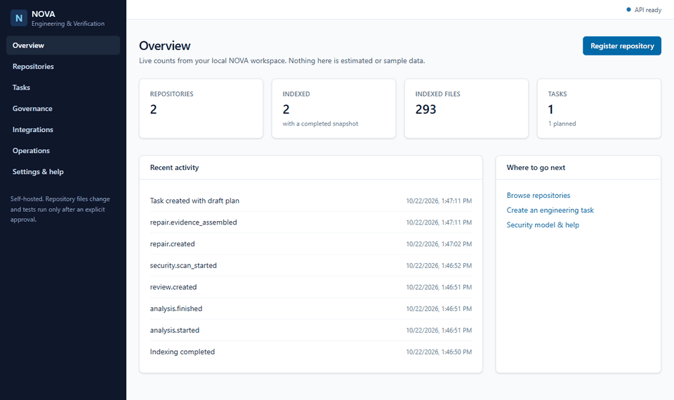
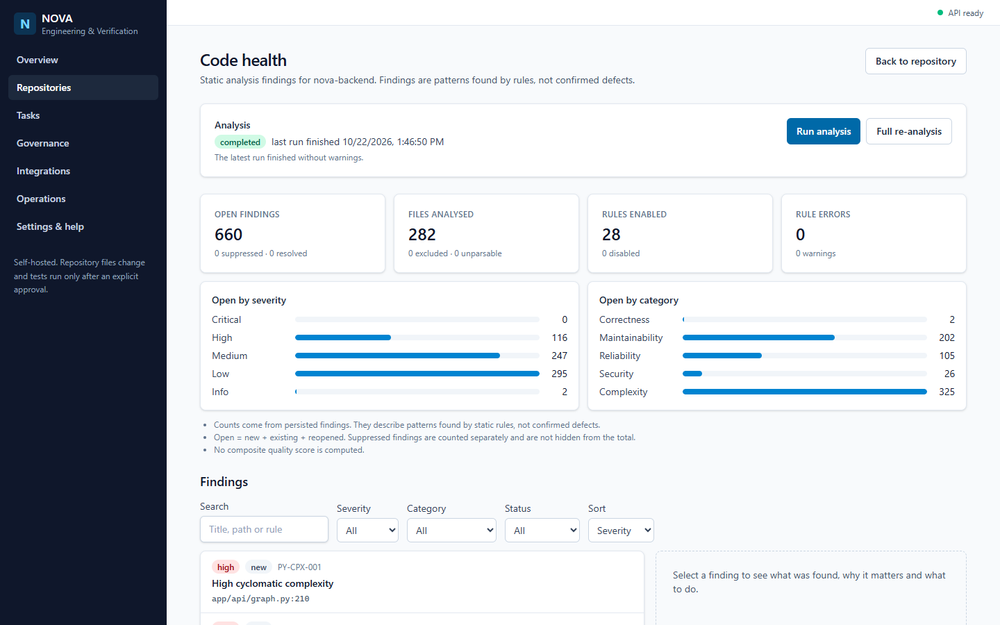
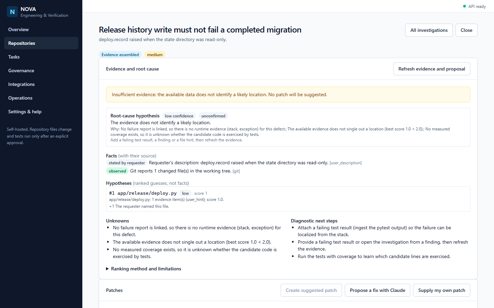
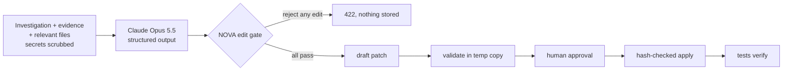
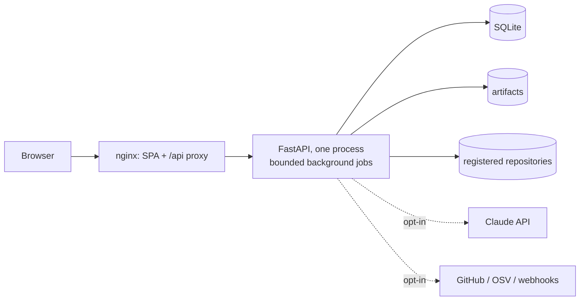

# NOVA — Software Engineering & Verification Platform

[](https://github.com/Mohhet-20/nova-code-verification-platform/actions/workflows/ci.yml)


[](LICENSE)

A self-hosted platform that indexes your repositories, finds defects, reviews changes, proposes repairs — by deterministic rules or with
**Claude** — and proves fixes with your tests. Its core rule: **nothing changes your code without validation, a human approval and
verification**, whoever (or whatever) proposed the change.

**Live demo: [nova-code-verification-platform.vercel.app](https://nova-code-verification-platform.vercel.app)** — choose
*Explore the live demo* to open NOVA analysing its own backend (details in [Hosted demo](#hosted-demo)).



| Code health (NOVA analysing itself) | Repair workflow with "Propose a fix with Claude" |
|---|---|
|  |  |

*Real screenshots of the production build behind nginx, against the production-mode API, with NOVA's own backend registered as the demo repository
(283 files, 7,897 symbols, 8,606 graph edges, 660 open findings).*

## What it does

| Area | Capability |
|---|---|
| Code intelligence | Safe, bounded indexing; tree-sitter symbols for Python / JavaScript / TypeScript; import and call graphs; impact analysis; dependency cycles |
| Static analysis | 28 Python rules (14 security incl. intraprocedural taint flow; correctness, reliability, maintainability, complexity) with a finding lifecycle and suppression |
| Code review | Reviews local Git changes: change-to-symbol mapping, explainable change risk, impacted tests |
| Testing | Test discovery, generated tests, approved execution in a restricted runner, measured branch coverage |
| Debugging & repair | Failure ingestion and localization; evidence-based investigations; patches from rules, people or **Claude**, all validated in isolation, approved, applied atomically and verified by tests |
| Delivery | Continuous verification, CI/PR readiness, supply-chain scanning, governance (teams, policies, approval workflows, audit), integrations, observability |

## Claude proposes, NOVA verifies

The LLM feature (`NOVA_AI_PROVIDER=anthropic`, off by default) is built so that the model is never trusted. Claude returns **schema-constrained
search/replace edits**; NOVA accepts them only if each edit targets a file it was shown, matches exactly one place, and avoids scrubbed secrets.
The result is an ordinary draft patch that still needs isolated validation, human approval and test verification.



Details, threat model and the 13 tests (fake client, no network): [`docs/architecture/AI_ASSISTED_REPAIR.md`](docs/architecture/AI_ASSISTED_REPAIR.md).

## Engineering highlights

* **871 backend tests** pass on Linux / Python 3.12 and Windows / Python 3.11; **203 frontend tests**; real-browser smoke (Chrome, Edge);
  route-wide sweeps assert that each of the **307 API operations** rejects missing or wrong credentials and enforces tenant isolation.
* **Security found by testing, not assumed:** a hostile repository test proved it could read the API's secrets from `/proc/<pid>/environ`;
  the API process is now non-dumpable, verified with a negative control. Git discovery was confined to the registered root after a
  repository nested inside another one leaked the outer repository into reviews.
* **Performance found by measurement:** the dependency-metrics endpoint collapsed from 86 to 10 req/s at 8 concurrent clients. Profiling ruled out
  the obvious suspects (cycle analysis took 2 ms; a GIL switch-interval A/B changed nothing) and isolated Python's `sqlite3` releasing the GIL
  on every row. Loading the graph as one SQLite row restored **74 req/s (p50 893 ms -> 95 ms)**, with an equivalence test against the old query.
* **Data safety:** 17 Alembic migrations with backup-first, locked upgrades; isolated restore only (never in place); a downgrade that refuses to
  run when it would destroy data; tamper-evident backups.
* **Production posture:** startup refuses weak or placeholder secrets and stale schemas; per-client throttling of invalid tokens; security headers;
  read-only, non-root containers with digest-pinned images; a CI job that boots the stack and runs end-to-end smoke tests and a restore.
* **Honest status reporting:** every limitation is written down — see [`docs/operations/FINAL_DEPLOYMENT_REPORT.md`](docs/operations/FINAL_DEPLOYMENT_REPORT.md)
  (for example, the container images have not yet been built on real Docker).

**Stack:** Python 3.12, FastAPI, SQLAlchemy 2, Alembic, SQLite, tree-sitter, Anthropic SDK · React 19, TypeScript, Vite, TanStack Query,
Tailwind · Docker Compose, nginx, Caddy · GitHub Actions.



## How this was built

NOVA was built phase by phase. Each of the 19 phases started from a written
specification that states the requirements, the safety rules and what counts as done. Every phase ended with tests,
a verification log ([`docs/implementation/VERIFICATION_LOG.md`](docs/implementation/VERIFICATION_LOG.md)) and an explicit list of what was *not*
verified. The interesting engineering is in the decisions written down in `docs/`: why the model only
proposes, why restores never happen in place, how a secret leak and a concurrency collapse were found and proven fixed.

Deployment: [`docs/operations/DEPLOYMENT_GUIDE.md`](docs/operations/DEPLOYMENT_GUIDE.md) · Architecture: [`docs/operations/ARCHITECTURE_AND_NETWORKING.md`](docs/operations/ARCHITECTURE_AND_NETWORKING.md) · Status: [`docs/implementation/PROJECT_STATUS.md`](docs/implementation/PROJECT_STATUS.md)

## Quick start (Windows PowerShell)
Prerequisites: Python 3.11+ (the full suite passes on Windows / 3.11 and Linux / 3.12), Node.js 20.19+ or 22.12+, npm. Git is needed for code review and CI features.
```powershell
cd "F:\last proj"
powershell -ExecutionPolicy Bypass -File scripts\setup.ps1      # venv, pip install, migrations, npm ci
powershell -ExecutionPolicy Bypass -File scripts\dev-backend.ps1   # terminal 1: API on http://127.0.0.1:8000  (docs: /docs)
powershell -ExecutionPolicy Bypass -File scripts\dev-frontend.ps1  # terminal 2: UI  on http://localhost:5173
```
Manual equivalent:
```powershell
cd backend
py -3.12 -m venv .venv
.\.venv\Scripts\python.exe -m pip install -r requirements-dev.txt
.\.venv\Scripts\python.exe -m alembic upgrade head                  # creates backend\data\nova.db
.\.venv\Scripts\python.exe -m uvicorn app.main:app --host 127.0.0.1 --port 8000 --reload
cd ..\frontend; npm ci; npm run dev
```
macOS/Linux: same commands with `python3 -m venv .venv`, `.venv/bin/python`, forward slashes.

## Try it safely
```powershell
python scripts\make_sample_repo.py "$env:TEMP\nova-sample" --git
```
Then in the UI: **Repositories → Register**, path `%TEMP%\nova-sample` → **Index** (10 files, with symbols for the Python and TypeScript files; the fake `.env`, `.pem`, ignored files,
`node_modules` and binaries are skipped) → **Tasks → New task** (e.g. “Fix login validation in src/auth/login.py”) → review/edit the plan.

## Hosted demo
The [live demo](https://nova-code-verification-platform.vercel.app) is the production build on free hosting: the React app on Vercel,
which proxies `/api/*` to the API on Render, so the browser only talks to its own origin.

- **What you see:** NOVA's own backend source and test suite as a Git repository, already indexed, statically analysed, security scanned and
  reviewed, with one uncommitted change for the review to assess (a bearer-token check that drops the constant-time comparison), an
  ingested failure under investigation and a task. All of it is produced through the public API at image build time
  ([scripts/demo_build.py](scripts/demo_build.py)), so a cold start takes seconds.
- **How you sign in:** *Explore the live demo* calls `POST /api/v1/auth/guest`, which issues a personal token for a shared guest account
  with the `engineer` role: it can browse everything, start analyses and reviews and draft repairs, but cannot manage members, teams or
  policies. The endpoint is off unless `NOVA_GUEST_ACCESS_ENABLED=true`, is throttled per address, and never issues an owner token. The
  owner signs in with the deployment's access key (`NOVA_API_TOKEN`, a hosting secret).
- **What is switched off:** running repository tests (`NOVA_TEST_EXECUTION_ENABLED=false`), so no visitor can make the server execute
  code, and AI-assisted proposals. The API runs with `NOVA_ENVIRONMENT=production`, so the startup guard enforces the rest.
- **Reset:** every start copies the showcase afresh ([scripts/demo_start.py](scripts/demo_start.py)); the free instance sleeps when idle,
  so the first request after a pause takes about a minute.

Deploy files: [render.yaml](render.yaml), [deploy/demo/Dockerfile](deploy/demo/Dockerfile), [frontend/vercel.json](frontend/vercel.json).
A real deployment uses [backend/Dockerfile](backend/Dockerfile) and [deployment/](deployment/) instead.

## Configuration
Environment variables (prefix `NOVA_`) or `backend/.env`; see `.env.example`. Defaults work out of the box.

## Checks
```powershell
powershell -ExecutionPolicy Bypass -File scripts\check-all.ps1
```
or individually — backend: `python -m ruff check .` and `python -m pytest`; frontend: `npm run typecheck`, `npm run lint`, `npm test`, `npm run build`.
Optional live contract test (needs a running backend): set `NOVA_LIVE_API` and `NOVA_LIVE_REPO_PATH`, then `npx vitest run src/test/live.test.tsx`.

## Performance check
`python scripts/measure_indexing.py --files 3000` (from `backend/`, venv active) generates a synthetic repository and prints timings
for first index, re-index, freshness and search along with the environment. Numbers are only meaningful with that environment.

## Troubleshooting
- **A language shows “Parser unavailable”** — the tree-sitter packages in `backend/requirements.txt` could not be loaded; reinstall them. NOVA still runs and says so.
- **UI says “API unavailable or not migrated”** — start the backend and run `alembic upgrade head` (check `GET /api/v1/ready`).
- **“Repository path does not exist”** — the path must exist on the machine running the *backend* and be absolute.
- **“Indexing is already in progress”** — a previous run is still going (or the backend was killed mid-run; see `docs/implementation/PROJECT_STATUS.md` known defects).
- **401 Unauthorized** — the backend has `NOVA_API_TOKEN` set, or you are using a per-user token that was rotated or removed; enter a valid token under **Settings & help**.
- **Port in use** — change `--port` and set `NOVA_BACKEND_URL` for the Vite proxy.
- **Execution policy blocks scripts** — run them with `powershell -ExecutionPolicy Bypass -File …` as shown.

## Documentation
`docs/implementation/PROJECT_STATUS.md` · `docs/architecture/OVERVIEW.md` · `docs/architecture/SECURITY_MODEL.md` ·
`docs/architecture/REPOSITORY_INTELLIGENCE.md` · `docs/architecture/INDEXING_DATA_MODEL.md` · `docs/security/REPOSITORY_INDEXING_THREAT_MODEL.md` ·
`docs/architecture/AI_ASSISTED_REPAIR.md` (Claude proposals) · `docs/operations/README.md` (deployment and operations) · `docs/architecture/OBSERVABILITY.md` (health, metrics, alerts, SLOs; UI at `/operations`) · `docs/architecture/PERFORMANCE.md` (benchmarks, budgets, optimizations) · `docs/architecture/INTEGRATIONS.md` (integrations, credentials, webhooks, API contracts, extensions; UI at `/integrations`) · `docs/architecture/GOVERNANCE.md` (teams, roles, policies, approval workflows, review queue, audit; UI at `/governance`) · `docs/implementation/VERIFICATION_LOG.md` · `CONTRIBUTING.md` · `CHANGELOG.md`

## Project layout

```
backend/            FastAPI app (app/), Alembic migrations, 871 tests, release CLI (python -m app.release)
frontend/           React + TypeScript SPA, Vitest tests, nginx config, real-browser smoke (e2e/)
deployment/         Docker Compose (+ optional Caddy TLS overlay), production env template
docs/architecture/  How each subsystem works and its limits (start with OVERVIEW.md, AI_ASSISTED_REPAIR.md)
docs/operations/    Deployment guide, configuration, backup/restore, runbooks, final deployment report
scripts/            Setup and check scripts, deployment smoke test, secret scanner
```

## License

[MIT](LICENSE)
