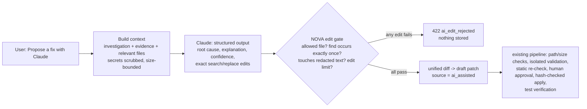

# AI-assisted repair: Claude proposes, NOVA verifies

NOVA's repair workflow produces patches from three sources. Only the third uses a language model, and it is off by default.

| Source | Produced by | Trust before review |
|---|---|---|
| `generated` | deterministic autofix rules (3 rules) | re-analysed by NOVA |
| `manual` | a person pastes a unified diff | none |
| `ai_assisted` | **Claude** (`NOVA_AI_PROVIDER=anthropic`) | **none** - treated exactly like `manual` |

The design principle: the model is a **proposer**, never an authority. Everything that decides whether a change is safe stays deterministic and
is shared with the other sources.

## Request

`POST /api/v1/repositories/{repository_id}/repairs/{repair_id}/patches` with `{"source": "ai_assisted"}`. Returns the draft patch (201) or an
explicit error:

| Code | Status | Meaning |
|---|---|---|
| `ai_disabled` | 409 | `NOVA_AI_PROVIDER` is not `anthropic`; nothing was sent |
| `ai_no_context` | 409 | no relevant file could be sent (all refused or over the size budget) |
| `ai_no_fix` | 409 | Claude returned no edits; its stated reason is passed through |
| `ai_edit_rejected` | 422 | at least one edit failed NOVA's gate; every problem is listed; nothing stored |
| `ai_declined` | 422 | Claude's safety classifier declined (after the server-side fallback); category returned |
| `ai_unavailable` | 503 | no/invalid credentials, timeout, network error, provider 5xx, truncated or non-JSON answer |
| `too_many_requests` | 429 | rate limited by the provider |

Provider error messages are never echoed (they can contain request details); the response names the condition.

## What is sent to Anthropic

The investigation's title, description and severity; the stored evidence (facts, hypotheses, unknowns); a summary of the source finding or
failure; and the full text of the investigation's **relevant files** only. Before sending, every file passes NOVA's patch-path checks (no
symlinks, no secret-bearing file names, size limits) and the secret scrubber (cloud keys, tokens, private-key blocks, `password=`/`token=`
assignments become `[REDACTED]`). The total is capped by `NOVA_AI_MAX_CONTEXT_BYTES`. Nothing is sent unless a user asks for a proposal.

## The edit gate

Claude answers in a fixed JSON schema (structured outputs, so the shape is guaranteed). For each edit NOVA requires:

1. `path` is one of the files that were sent - so the model cannot touch anything outside the investigation's scope (including `../` paths);
2. `find` occurs **exactly once** in the current file - ambiguous or invented anchors are refused rather than guessed;
3. neither `find` nor `replace` contains `[REDACTED]` - the model never saw those values, so it must not edit them;
4. at most `NOVA_AI_MAX_EDITS` edits.

If any edit fails, the whole proposal is refused. A passing proposal becomes a unified diff and a **draft** patch whose summary records the
model actually used, the request id, the model's confidence and its root-cause statement; the audit event stores the full provenance
(requested and served model, request id, token usage, whether a refusal fallback ran).

## Prompt injection

Repository files are untrusted. The system prompt tells Claude to treat them as data, but the defence does not depend on that: the output is
schema-constrained, the edit gate limits *where* changes can go, and a human must approve before anything is written. A file that "instructs"
Claude to edit `.github/workflows/` or another file can at most produce a rejected proposal.

## Model and API usage

* Model `claude-opus-5-5` by default (`NOVA_AI_MODEL`), adaptive thinking (always on for this model), `output_config.effort` from `NOVA_AI_EFFORT`
  (default `high`), structured output via `output_config.format`.
* Server-side refusal fallback (`fallbacks: "default"`, beta `server-side-fallback-2026-07-01`) for models that support it, so a policy decline is
  re-run on Anthropic's recommended fallback model; the plain endpoint is used for other models.
* Official `anthropic` Python SDK 1.12.1; credentials are whatever the SDK finds (`ANTHROPIC_API_KEY`, `ANTHROPIC_AUTH_TOKEN`, or an
  `ant auth login` profile). NOVA has no setting that holds an Anthropic secret, and the API process is non-dumpable, so repository test code
  cannot read the key from `/proc`.

## Configuration

| Variable | Default | Notes |
|---|---|---|
| `NOVA_AI_PROVIDER` | `none` | `anthropic` enables proposals; production `check-config` then warns `ai_egress` |
| `NOVA_AI_MODEL` | `claude-opus-5-5` | any Claude model id |
| `NOVA_AI_EFFORT` | `high` | `low`/`medium`/`high`/`xhigh`/`max`; invalid values fall back to `high` |
| `NOVA_AI_TIMEOUT_SECONDS` | `180` | per request; the SDK retries 429/5xx twice |
| `NOVA_AI_MAX_CONTEXT_BYTES` | `120000` | repository text per request |
| `NOVA_AI_MAX_EDITS` | `20` | edits per proposal |

Task planning remains deterministic with either setting.

## Verification

`backend/tests/test_ai_repair.py` (13 tests, fake Anthropic client - no network): the full proposal -> validate -> submit -> approve -> apply
flow; that the secret never leaves the server and unrelated files are not sent; each gate rule (file outside scope, `../`, ambiguous and missing
anchors, redacted text, mixed valid/invalid edits) rejects the whole proposal and stores nothing; no-fix, refusal, truncation, authentication,
rate-limit and connection errors; request shape (model, effort, structured output, fallbacks); production warnings; migration `0017` (widens the
source constraint; downgrade refuses while AI-assisted rows exist). Frontend: `src/test/repair.test.tsx` (3 tests).

**Not verified:** a call to the real Anthropic API - no credentials were available where this was built. Run one proposal on staging with a
key before relying on it, and evaluate proposal quality on your own repositories.
