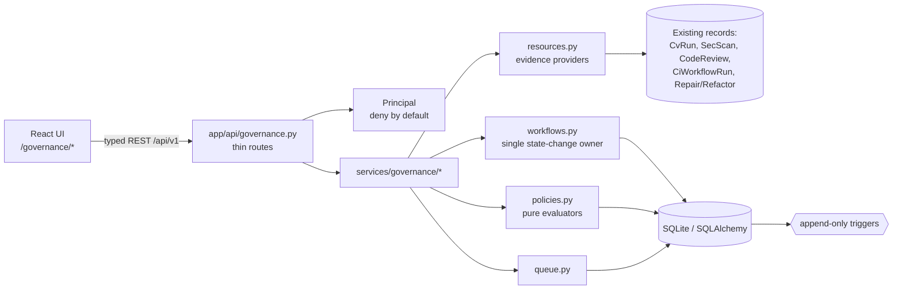
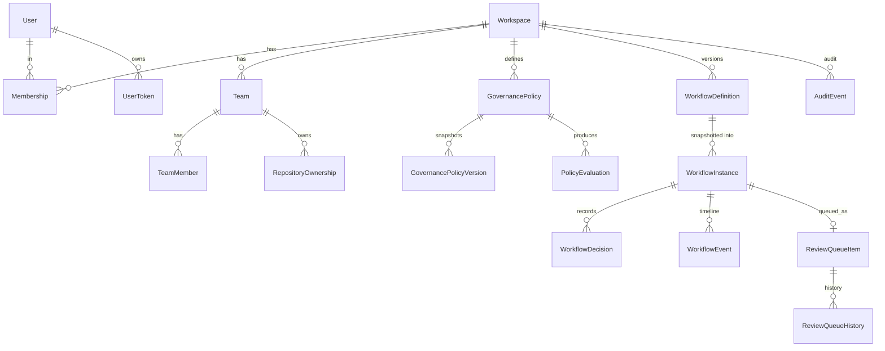
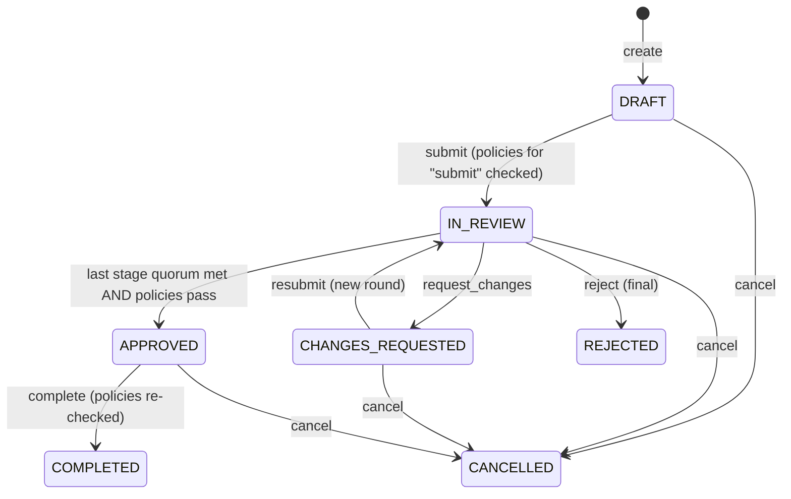

# Enterprise governance, team collaboration and workflow orchestration

Status: **PARTIAL** — backend, migration and the main governance UI are implemented and verified locally (Linux / Python 3.12, SQLite); the screens listed under "Known limits" are API-only. See "Known limits" before relying on any claim here.

## 1. What exists

| Area | Implementation |
|---|---|
| Organization | The existing `Workspace` is the tenant. `Membership.role` is the organization role; `Membership.status`/`removed_at` were added (migration `0015`). |
| Identity | Per-user API tokens (`nova_u_…`, SHA-256 digest stored, shown once, rotatable, revoked on removal). The legacy global bearer token and local-trust mode still map to the local organization owner. |
| Teams | Teams, team memberships (`admin` / `member` / `reviewer`), repository ownership (one owning team per repository, optional accountable member). |
| Authorization | One deny-by-default module, `app/security/authz.py` (`Principal`). Every governance route and service calls it; denials are audited. |
| Policies | Versioned, declarative, data-only; evaluated deterministically against persisted evidence; evaluations are stored with the policy version. |
| Workflows | Versioned definitions, snapshotted into each instance; one domain service (`app/services/governance/workflows.py`) owns every state change. |
| Review queue | Persistent, scoped, filterable, paginated; assign / claim / release with history. |
| Audit | Append-only tables protected by SQLite triggers; read-only API. |
| UI | `/governance` (overview), `/governance/approvals`, `/governance/queue`, `/governance/teams[/:id]`, `/governance/workflows/:id`, `/governance/policies`, `/governance/audit`. A "Request governance review" button on the code-review, refactoring and change-request detail pages starts a workflow (confirmation dialog, then the server decides). |

## 2. Architecture



Rules that shape the design:

* The UI never decides anything. It sends a decision and renders whatever state the server returns; there is no client-side "approved" state.
* A client cannot supply a user id, role, organization id, evaluation result or workflow state — request models use `extra=forbid` and these fields do not exist.
* The policy engine never executes code, shell commands or repository content. A policy is a type name plus a validated config.

## 3. Roles and permissions

Organization roles come from `Membership.role`; team roles from `TeamMember.role`. The matrix below is generated from `ORG_PERMISSIONS` / `TEAM_PERMISSIONS`; the organization **owner** holds every permission (`*`), including the owner-only ones not listed in a column: `org.members.manage`, `team.archive`, `policy.manage` (create/edit/disable blocking policies), `workflow.definition.manage`.

| Permission | owner | maintainer | engineer | reviewer | auditor | viewer | team admin | team member | team reviewer |
|---|---|---|---|---|---|---|---|---|---|
| `audit.view` | ✓ |  |  |  | ✓ |  |  |  |  |
| `audit.view_team` | ✓ | ✓ |  |  |  |  | ✓ |  |  |
| `definition.view`, `policy.view` | ✓ | ✓ | ✓ | ✓ | ✓ | ✓ |  |  |  |
| `ownership.assign` | ✓ |  |  |  |  |  | ✓ |  |  |
| `policy.manage_advisory` (non-blocking policies) | ✓ | ✓ |  |  |  |  |  |  |  |
| `queue.assign` | ✓ | ✓ |  |  |  |  | ✓ |  |  |
| `queue.claim` | ✓ | ✓ |  | ✓ |  |  | ✓ |  | ✓ |
| `queue.enqueue` | ✓ | ✓ | ✓ |  |  |  | ✓ | ✓ |  |
| `queue.view_all`, `team.view_all`, `workflow.view_all` | ✓ | ✓ |  |  | ✓ |  |  |  |  |
| `team.create` | ✓ | ✓ |  |  |  |  |  |  |  |
| `team.members.manage`, `team.update` | ✓ |  |  |  |  |  | ✓ |  |  |
| `workflow.create`, `workflow.submit` | ✓ | ✓ | ✓ |  |  |  | ✓ | ✓ |  |
| `workflow.cancel_own` | ✓ |  | ✓ |  |  |  | ✓ | ✓ |  |
| `workflow.cancel`, `workflow.complete` | ✓ | ✓ |  |  |  |  |  |  |  |
| `workflow.decide` | ✓ | ✓ |  | ✓ |  |  |  |  | ✓ |

Notes:

* *Who may decide a particular stage* is the intersection of the permission above and the stage's `approver_roles` / `approver_team_roles` (the default stage allows organization `owner`, `maintainer`, `reviewer` and team `admin`, `reviewer`), and independence (below).
* Organization-wide visibility (`owner`, `maintainer`, `auditor`) sees all teams. Everyone else sees only their own teams' repositories, workflows and queue items, plus unowned repositories (legacy behaviour: repositories registered before teams existed remain workspace-visible).
* **Separation of duties.** A stage marked `independent` (the default) excludes the requester and the resource author, even if they hold an approving role (including the organization owner). Nobody can decide twice in the same stage and round (also enforced by a database unique constraint).
* **Last administrator.** The last active organization `owner` cannot be demoted or removed (HTTP 409). A team keeps at least one `admin`.
* **Error semantics.** Resources outside the caller's scope (other organization, other team's repository) return **404** exactly like missing ones; in-scope but unauthorized operations return **403**. Denials are written to the audit log as `authz.denied` (de-duplicated per user and permission for 60 s so a probing client cannot flood it).

### Tenant isolation boundaries

* The organization is the workspace; every governance table carries `workspace_id` and every query filters on the caller's workspace before anything else. The caller's workspace comes from the authenticated token, never from a request field.
* Referenced ids are re-checked in the caller's workspace: adding a team member requires an **active member of the same organization**; assigning ownership requires a repository in the same organization; a queue assignee must be an eligible member.
* Team scope is a second boundary inside the organization: roles without organization-wide visibility see only their teams' repositories, workflows and queue items. Guessing ids returns 404 (identical to "does not exist").
* The API has no endpoint that reads across organizations. Isolation is covered by `test_cross_tenant_isolation` and `test_restricted_team_resources_are_hidden_from_non_members`.

## 4. Data model



Integrity enforced by the database: unique `(team_id, user_id)`; one live workflow per resource (partial unique index); one active definition per key (partial unique index); unique `(instance_id, round, stage_index, user_id)` decisions; state / role / severity CHECK constraints; optimistic locking (`row_version`) on workflow instances; indexes for every filtered or ordered list.

## 5. Workflow state machine



* Transitions (`submit`, `resubmit`, `cancel`, `complete`) and decisions (`approve`, `reject`, `request_changes`, `abstain`) are different API calls. **Approval is only reachable through a decision**; no transition or field update can set `APPROVED`.
* Stage modes: `sequential` (stage *n+1* opens after stage *n* reaches `min_approvals`) or `parallel` (all stages open; the workflow is approved when every stage is satisfied). `abstain` records a review without counting as approval.
* A decision runs in one transaction inside a SAVEPOINT. If the decision would make the workflow `APPROVED` but a blocking policy fails or is unavailable, the savepoint is rolled back (the decision is **not** stored), the evaluation results and an audit record **are** stored, and the API answers **409 `policy_blocked`** with the blockers. The reviewer can retry after the evidence exists.
* A second concurrent writer cannot silently overwrite the first: the loser gets 409 (optimistic lock or unique-constraint violation). The concurrency test starts four simultaneous approvals; exactly one succeeds.
* Each instance stores a snapshot of its definition, so editing the definition never changes running workflows.

## 6. Policies

Policy = `{key, name, policy_type, resource_types[], severity, enabled, config, team_id?, repository_id?}`. `severity` is `blocking | warning | informational`. Creating or editing writes a new row in `governance_policy_versions` (append-only); no-op edits do not create versions.

| `policy_type` | `config` (extra keys rejected) | Evidence used |
|---|---|---|
| `required_reviewers` | `min_reviewers: int = 1` | distinct reviewers who decided in this round |
| `independent_approvals` | `min_approvals: int = 1` | approvals from people other than requester and author |
| `verification_required` | `allowed_outcomes: ["PASS", …]` | latest continuous-verification gate outcome **for the same revision**, or the resource's recorded verification summary |
| `code_review_completed` | – | a completed code review for the same revision |
| `max_change_risk` | `max_level: low\|moderate\|high\|critical = high` | code-review risk category |
| `security_checks_required` | `max_open_critical = 0`, `max_open_high = 0` | latest security scan summary |
| `evidence_required` | `labels: [str]` | attested evidence labels (see limits) |
| `prohibited_transition` | `transition: str`, `when_risk_at_least?: level` | the transition being attempted |
| `release_readiness` | `allowed: [str]` | CI/CD release-readiness result |

Evaluation statuses: `pass`, `fail`, `warning`, `unavailable`, `not_applicable`. Safety properties (each covered by tests):

* **No evidence → `unavailable`, never `pass`.** For a `blocking` policy, `fail` and `unavailable` both block; for a `warning` policy they surface as `warning`.
* **Unknown policy type** (for example written by a newer version) → `unavailable` + blocking if its severity says so. It is never skipped.
* Evidence for another revision (commit SHA) never counts.
* **Phases.** `prohibited_transition` is enforced at every transition; other blocking policies are enforced at `approve` (final stage) and `complete`. A definition's `required_policy_keys` are always enforced at those two points, and a required policy that is missing or disabled blocks.
* Only the organization owner may create, escalate, edit or disable **blocking** policies. Leads may manage advisory ones; a lead cannot raise a policy to blocking or switch off a blocking one.

Default policies installed by `POST /governance/seed-defaults` (idempotent): `independent-approval` (blocking), `verification-passed` (blocking; repair patch / refactor / change request), `code-review-completed` (warning), `risk-ceiling` (warning). Default definitions: `code-review-review`, `repair-patch-review`, `refactor-review`, `change-request-review` — one independent approval each.

## 7. API (all under `/api/v1`, paginated lists return `{items,total,page,page_size,pages}`)

| Group | Endpoints |
|---|---|
| Identity / org | `GET /governance/me`; `GET|POST /org/members`; `PUT /org/members/{id}/role`; `POST /org/members/{id}/remove`; `POST /org/members/{id}/token` |
| Teams | `GET|POST /teams`; `GET|PUT /teams/{id}`; `POST /teams/{id}/archive`; `GET|POST /teams/{id}/members`; `PUT|POST /teams/{id}/members/{user}[/remove]`; `GET|PUT /teams/{id}/ownership`; `POST /teams/{id}/ownership/{repo}/release`; `GET /teams/{id}/work` |
| Policies | `GET /governance/policy-types`; `GET|POST /governance/policies`; `GET|PUT /governance/policies/{id}`; `GET …/versions`; `POST /governance/seed-defaults`; `POST|GET /governance/evaluations` |
| Workflows | `GET|POST /workflows/definitions`; `GET|POST /workflows/instances`; `GET /workflows/instances/{id}[/events|/policy-status]`; `POST …/transitions`, `…/decisions`, `…/evidence` |
| Queue | `GET|POST /review-queue`; `GET /review-queue/summary`; `POST …/{id}/assign|claim|release`; `GET …/{id}/history` |
| Audit / ops | `GET /governance/audit` (read-only); `GET /governance/overview`; `GET /governance/health` |

Mutations use `POST`/`PUT` only (the CORS configuration allows GET, POST, PUT).

Examples:

```bash
# create a team (org owner/maintainer)
curl -sX POST localhost:8000/api/v1/teams -H 'Content-Type: application/json' -d '{"name":"Payments","description":"Payments platform"}'

# add a person (returns their token once)
curl -sX POST localhost:8000/api/v1/org/members -H 'Content-Type: application/json' -d '{"handle":"rita","display_name":"Rita","role":"reviewer"}'

# start and submit a workflow for a code review
curl -sX POST localhost:8000/api/v1/workflows/instances -H "Authorization: Bearer $ENG" -H 'Content-Type: application/json' \
     -d '{"resource_type":"code_review","resource_id":"<id>","priority":"high"}'
curl -sX POST localhost:8000/api/v1/workflows/instances/<wf>/transitions -H "Authorization: Bearer $ENG" -H 'Content-Type: application/json' -d '{"action":"submit"}'

# an independent reviewer decides
curl -sX POST localhost:8000/api/v1/workflows/instances/<wf>/decisions -H "Authorization: Bearer $REVIEWER" -H 'Content-Type: application/json' \
     -d '{"decision":"approve","justification":"Reviewed the migration"}'
```

A blocked approval:

```json
{"error":{"code":"conflict","message":"Blocked by governance policy: Cannot be evaluated: …","details":{"code":"policy_blocked","blockers":["verification-passed"],"results":[…]}}}
```

## 8. Audit

`audit_events`, `workflow_events`, `workflow_decisions`, `policy_evaluations`, `governance_policy_versions` and `review_queue_history` are append-only: SQLite triggers (`trg_<table>_no_update` / `_no_delete`) abort `UPDATE` and `DELETE`. The only tolerated update is setting an actor column to NULL (for anonymising a deleted user). The API has no create/update/delete endpoint for audit records. Sensitive keys (tokens, secrets, passwords, hashes) are redacted and values are length-bounded before being written.

**This is tamper-resistant against application bugs and ordinary SQL, not tamper-proof.** Anyone with write access to the SQLite file can drop the triggers or rewrite the file. There is no hash chain or signature. Do not describe these records as cryptographically immutable.

Audit event schema (`audit_events`): `id`, `workspace_id`, `actor_user_id` (nullable; set to NULL only when anonymising), `action` (for example `team.created`, `team.member_added`, `member.role_changed`, `ownership.assigned`, `policy.created` / `policy.updated` / `policy.enabled` / `policy.disabled`, `workflow.created`, `workflow.submit`, `workflow.decision.approve`, `workflow.approval_blocked`, `queue.claimed`, `authz.denied`), `entity_type`, `entity_id`, `details` (JSON: `outcome`, optional `team_id`, bounded safe context such as `from` / `to` / `round`; justification **text** lives in `workflow_decisions`, the audit row records only whether one was given), `created_at`. Workflow history is additionally kept as typed `workflow_events` and `workflow_decisions`.

**Retention, backup and removal.** Nothing deletes governance history: users and teams are marked `removed` `archived`, and decisions, events and audit rows keep their ids so history stays attributable (tested). There is **no retention policy, purge job or export**; the tables grow without bound. Back up the SQLite file (`backend/data/nova.db`) with the application stopped or using SQLite's online backup, and treat backups as containing justifications and user handles. If a retention period is required, add an archival job that copies rows to protected storage before any purge, and note that the append-only triggers deliberately block `DELETE`.

## 9. Observability

* Metrics (`GET /api/v1/ops/metrics`): `nova_governance_policy_evaluations_total{policy_type,status}`, `nova_governance_transitions_total{action,outcome}`, `nova_governance_workflow_duration_seconds{outcome}`, and gauges `nova_governance_queue_open_items`, `nova_governance_workflows_in_review` (updated when the overview/health is read). No user, team, repository or workflow ids appear as labels (tested).
* Structured logs (logger `nova.governance`): `governance_event` (action, entity type and id, outcome, team id, actor id) for every audited action and `policy_evaluated` (policy key, version, type, status, blocking, trigger, resource id). They carry identifiers only: no justification text, handles, tokens or source contents.
* `GET /governance/health` (owner, maintainer, auditor) reports whether an administrator exists, policies and definitions are configured, and the append-only triggers are present. It reports `scheduler: not_implemented`.
* Performance: list endpoints are paginated (page size ≤ 100), views are batch-loaded (a test bounds the SQL statement count for 12 workflows), and the filtered/ordered columns are indexed.

## 10. Operating it

```bash
cd backend
python -m alembic upgrade head           # adds migration 0015; never drops data
python -m alembic check                  # "No new upgrade operations detected"
python -m uvicorn app.main:app            # start the API
curl -X POST localhost:8000/api/v1/governance/seed-defaults   # install default policies/definitions (org owner)

# tests
python -m pytest tests/test_governance.py -o addopts=""   # 38 tests
cd ../frontend && npx vitest run src/test/governance.test.tsx   # 21 tests
```

Downgrade: `python -m alembic downgrade 0014` removes the governance tables and triggers and the two `memberships` columns (governance data is lost; keep a backup).

## 11. Known limits

* **Missing UI (API exists and is tested):** organization member directory and member management, policy detail / create / edit / version history, workflow-definition screens, and repository-ownership assignment (the UI lists ownership read-only). The UI also has no accessibility audit.
* **No scheduler.** Nothing escalates, expires, sends reminders or becomes "overdue"; `overdue` is always `null`. SLAs are not implemented.
* **No notifications** for assignments or decisions; the queue is pull-based.
* **No organization-creation API**; the single local workspace is the organization. Multi-organization behaviour is covered by tests that insert a second workspace directly.
* **No SSO / OIDC / SCIM**; identities are local users with API tokens. Tokens are bearer secrets; anyone holding one acts as that user.
* **Audit is not cryptographically immutable** (section 8). Append-only triggers are SQLite-specific; a PostgreSQL deployment needs equivalent triggers or revoked `UPDATE`/`DELETE` privileges (not implemented or tested).
* **Evidence labels are attestations.** `evidence_required` and the `/evidence` endpoint record what a person says exists; they cannot satisfy `verification_required` (tested).
* **Unowned repositories remain visible to the whole workspace** for backward compatibility; assign ownership to restrict them.
* **Governed resource types:** `code_review`, `repair_patch`, `refactor`, `change_request`. Other records are not governed yet.
* **No comments / discussion threads, delegation, or out-of-office reassignment.**
* Concurrency was tested with threads against SQLite in one process; multi-process and PostgreSQL behaviour are unverified.
* The UI was tested with jsdom and mocked fetch, not in a real browser; accessibility was reviewed against code (roles, labels, focus handling) but not audited with assistive technology.
