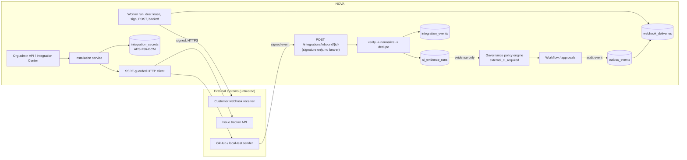

# Enterprise integrations, API contracts and extensions (Phase 16)

Status of this document: describes what is **implemented and tested** in Phase 16. Anything marked *deferred* or *not verified* is not claimed.
The tenant ("organization") is the existing `Workspace`; every integration table carries `workspace_id`, and every query is scoped to it.

## 1. Architecture



Concerns are separate tables and modules (`app/services/integrations/`): definitions (compiled-in `registry.py`), installations/credential references
(`service.py`, `secrets.py`), inbound events (`inbound.py`), outbound events and deliveries (`outbox.py`), jobs (`jobs.py`), extension registrations
(`extensions.py`), external links (`links.py`), idempotency (`idempotency.py`) and outbound HTTP (`netguard.py`).

**Adapter interface** (`registry.Adapter`): `validate_config`, `test_connection`, `verify_inbound`, `normalize_inbound`, `publish_status`,
`search_issues`, `get_issue`, `create_issue`, `manifest` (capabilities, permissions, config JSON schema). Unsupported operations raise `Unsupported`
and are reported as such (HTTP 422 or `category: "unsupported"`), never as success. Built-ins: `github` (version control + CI evidence),
`github-issues` (issue tracker), `local-test` (clearly labelled; no network, no credential).

## 2. Public API contract

* Base `/api/v1`. JSON only. Error envelope: `{"error": {"code", "message", "details?"}}`; no stack traces. Unknown request fields are rejected (`extra=forbid`), so there is no mass assignment.
* Lists are `{items, total, page, page_size, pages}` with a stable order (creation time, then id) and `page_size <= 100`.
* Identity, role and organization always come from the server-side token, never from the body. Cross-organization ids answer 404.
* Governance: `app/contracts.py` reduces the generated OpenAPI to a stable summary. `contracts/openapi.baseline.json` is checked in; `tests/test_api_contract.py`
  fails on removed operations, newly required parameters/properties, removed or retyped properties. Additive optional changes pass. To accept an intentional change:
  `python -m app.contracts write` and review the diff. **Deprecation convention:** mark the operation `deprecated=True`, keep it working for at least one minor release, then remove it.
* **Idempotency** (`Idempotency-Key`, 8-80 chars) on `POST /integrations/issues`: scoped to (organization, user, route), expires after 24 h, bound to the payload hash
  (reuse with a different payload -> 422 `idempotency_key_reused`), and a replay returns the stored response with `Idempotent-Replay: true`. It is a replay guard, never authentication.
  Secret-bearing responses (installation/subscription creation) deliberately do **not** use idempotency records, because that would persist the secret.

Key endpoints (all `integration.*`/`webhook.manage`/`extension.manage` permission checked; owner = `*`): `GET /integrations/catalog|health|installations|ci-evidence|links|jobs|extensions`,
`POST /integrations/installations`, `.../{id}/test|enable|disable|credential|webhook-secret/rotate|revoke|check`, `GET .../{id}/events`, `POST /integrations/inbound/{id}`,
`/integrations/webhook-subscriptions` (+ `rotate-secret`, `remove`), `/integrations/webhook-deliveries` (+ `replay`), `POST /integrations/worker/run`, `POST /integrations/extensions/validate|{id}/enable|disable`.
Maintainers and auditors may view; only organization owners manage (maintainers may link existing issues).

## 3. Credentials (threat model)

| Threat | Mitigation |
|---|---|
| DB or backup disclosure | Credentials and signing secrets are stored only as AES-256-GCM envelopes (`v1.` + nonce + ciphertext). The key is **not** in the database. |
| Ciphertext moved to another row/org | AAD = `organization:owner_type:owner_id`; decryption fails elsewhere. |
| Missing/invalid key | **Fail closed**: storing or reading a stored credential raises `SecretsUnavailable` -> HTTP 503 `secrets_unavailable`. No default, no derived fallback key. |
| Secret exfiltration through API/logs | Secrets are returned once (creation/rotation) and never by reads; audit details, logs, metrics and delivery excerpts are redacted/never contain them. |
| `env:` reference used to read arbitrary env vars | References must match `env:NOVA_CRED_*`. |
| Rotation | Replace credential: new row, old row `revoked_at` set (history kept). Key rotation: set the new key in `NOVA_INTEGRATION_SECRET_KEY`, the old in `NOVA_INTEGRATION_SECRET_KEYS_PREVIOUS`, call `secrets.reencrypt_all`, confirm `undecryptable == 0`, then drop the previous key. Generate keys with `python -m app.services.integrations.secrets generate-key`. |

**Not claimed:** this is application-level encryption with an environment-supplied key. It is **not** a deployment-grade secrets manager/HSM/KMS. Anyone who can read both the process environment and the database can decrypt.
Production deployments should inject the key from their platform secret store and restrict database access; a KMS-backed provider is a future provider behind the same functions (*deferred*).
Not verified: behaviour against a real GitHub account or any live credential (all HTTP in tests is mocked).

## 4. SSRF protections (`netguard.py`, `observability/notify.py`)

Applied to **every** outbound request (connection tests, issue calls, status publishing, webhook deliveries) at connection time: https required (http only if `NOVA_INTEGRATION_ALLOW_PRIVATE_DESTINATIONS`, off by default),
no credentials in URL, cloud-metadata hosts refused, **all** DNS answers must be public (loopback/private/link-local/reserved/multicast/metadata blocked, IPv4-mapped IPv6 unwrapped), the request connects to the validated IP (no second lookup, so no rebinding),
redirects are **never followed** (3xx -> `redirect_blocked`), timeouts and response-size caps apply, and installation destinations come only from validated stored config (the test endpoint accepts no URL).
Optional host allowlist per call (the GitHub adapter pins the configured API host). Subscription URLs are validated on create/update **and** again on every delivery.
Limitations: TLS verification uses the system trust store; there is no egress firewall in the app; a hostname that resolves publicly at validation and the same IP is used for the connection, but intermediaries (corporate proxies) are not modelled.

## 5. Inbound webhooks and CI evidence

Order: size cap (`NOVA_INTEGRATION_INBOUND_MAX_BYTES`, default 256 KiB, streamed) -> uniform 404 for unknown/removed installations -> 403 if disabled -> rate limit (300/min per installation, in-process) -> **signature over raw bytes** (GitHub `X-Hub-Signature-256`, local-test `X-Nova-Signature`, constant-time compare) -> `Content-Type: application/json` (415) -> JSON/structure (422 `payload_invalid`) -> repository mapping -> dedupe on unique `(installation, delivery_id)` (duplicates return 200 `duplicate`) -> persist a minimal summary (never the raw payload) -> process.
Separated outcomes: 401 auth failure, 415/422 invalid, 200 duplicate, 200 `failed` (recorded `processing_error`, payload not logged). Auth failures are not persisted. Replay window: GitHub does not sign timestamps, so the replay defense is delivery-id dedupe; the outbound signature does include a timestamp and the reference verifier enforces a tolerance.
CI events create `ci_evidence_runs` rows only (`pending|success|failed|cancelled|unknown`; a late `pending` never downgrades a terminal state). No inbound event can approve, release or change a workflow. The `external_ci_required` policy type reads this evidence for **the same commit**: missing, pending, cancelled, unknown or older than `max_age_hours` -> `unavailable` (never a pass); any failed run -> fail; only all-fresh-success passes.
External content is untrusted data: nothing selects a path, command or URL, and PR code is never fetched or executed.

## 6. Outbound webhooks

```mermaid
sequenceDiagram
  participant U as User request
  participant DB as DB (one transaction)
  participant W as Worker
  participant R as Receiver
  U->>DB: change + audit + outbox_event + webhook_deliveries(pending)
  Note over U,DB: user request returns; nothing waits on the receiver
  W->>DB: claim due rows (lease_until = now + lease)
  W->>R: POST envelope + X-Nova-Signature t=..,v1=HMAC(secret, t.body)
  alt 2xx
    W->>DB: succeeded
  else 408/425/429/5xx/timeout
    W->>DB: retrying, next = base * 2^(n-1) capped; permanent after max attempts
  else other 4xx / blocked / redirect
    W->>DB: failed (permanent)
  end
```

Envelope: `{schema_version:"1", event_id, type, created_at, organization_id, resource:{type,id}}` (no content). Events: `workflow.created`, `workflow.state_changed`, `workflow.decision_recorded`, `integration.health_changed`, `ci.run_recorded` (allowlist; unknown types are rejected). **Wired:** the three `workflow.*` events (from governance audit writes). Also wired: `ci.run_recorded` (when evidence is recorded) and `integration.health_changed` (when a connection test changes the status). Review/verification-completed events do not exist in NOVA yet and are therefore not offered.
Guarantees: **at-least-once, not exactly-once** - receivers must de-duplicate on `X-Nova-Event-Id`. Crash recovery: a claimed delivery whose lease expires is re-claimed by the next `run_due`. Replay is admin-only and resets a *finished* delivery for a fresh bounded cycle (attempt history kept). Consecutive final failures auto-pause a subscription (`too_many_failures`). Response bodies are stored only as a 300-character scrubbed excerpt.

## 7. Jobs and the worker

`integration_jobs`: operation (closed set: `connection_check`), identifiers-only `input_ref`, state `queued|running|succeeded|failed|dead`, attempts, `scheduled_at`, `lease_until`, error category, correlation id; one live job per (operation, installation). Retries use the same exponential backoff and stop at `max_attempts` -> `dead`. Nothing re-schedules itself (no unbounded polling).
**Run it:** `POST /integrations/worker/run` (admin; one bounded batch), or set `NOVA_INTEGRATION_WORKER_ENABLED=true` to start the in-process loop at API startup (interval `NOVA_INTEGRATION_WORKER_INTERVAL_SECONDS`). **Stop:** unset and restart; in-flight work simply has an unexpired lease. **Recovery after restart:** leases expire and rows are re-claimed; `queue_stats`/`/integrations/health` report depth, oldest due age and a `stuck` flag (> 15 min). With the worker disabled, deliveries stay `pending` (visible, not lost). No Redis/Kafka.

## 8. Extensions

Manifest (`extensions.Manifest`, strict): `id, name, version, category, nova_compatibility, capabilities, permissions, config_schema, provenance`. There is **no field** for a module, entry point, URL or command. `POST /integrations/extensions/validate` is a pure schema dry run and always reports `installable:false` for anything outside the compiled-in registry. Only built-ins (`github`, `github-issues`, `local-test`, `webhook-notifier`) can be enabled; nothing is imported from a DB row, path or request parameter, and uploaded code is never executed. Extension permissions are a closed set that excludes writing audit, approvals or policy outcomes. **Deferred:** loading external extension code (needs signing, sandboxing, review).

## 9. Observability and failure modes

Metrics (bounded labels only): `nova_integration_connection_tests_total`, `nova_integration_inbound_total`, `nova_webhook_delivery_attempts_total`, `nova_webhook_delivery_seconds`, `nova_integration_jobs_total`, `nova_integration_queue_depth`, `nova_integration_oldest_due_age_seconds`, `nova_extension_runs_total` (defined; no built-in extension executes code, so it is not incremented yet). Logs carry installation ids and categories, never payloads or secrets.
A *disabled* installation is a deliberate state (`health: disabled`); *failing* means enabled and the last check failed. Integrations are optional: startup never contacts them.
| Failure | Effect |
|---|---|
| No encryption key | Stored credentials/secrets 503; `env:` references and the local-test adapter still work; health shows `secrets.configured:false` |
| Receiver down | Deliveries retry then fail; user requests unaffected; subscription auto-pauses after repeated failures |
| Worker not running | Deliveries stay pending; `outbound_queue.stuck` after 15 min |
| Provider outage | Connection test `failing` with a sanitized category; no data fabricated |

## 10. Data, retention, backup and rollback

Migration `0016` adds 12 tables (indexes for dedupe, subscription lookup, delivery due-scans, job scheduling, scope). It never drops data and is reversible (`alembic downgrade 0015` drops only the new tables; verified by a data-preservation test).
Retention (documented, not automated): inbound events and finished deliveries/attempts: `NOVA_INTEGRATION_EVENT_RETENTION_DAYS` (default 30) is the intended window; no purge job ships in this release, `idempotency.purge_expired` is available. CI evidence and audit events are kept.
Backup: back up the SQLite file **and** keep the encryption key separately; ciphertext is useless without the key and the key must not be stored beside the backup. Recovery: restore the file, provide the same key (and previous keys), run the worker.

## 11. Examples (non-secret values)

```bash
# create a local-test installation (no credential)
curl -X POST $NOVA/api/v1/integrations/installations -H "Authorization: Bearer $TOKEN" -H 'Content-Type: application/json' \
  -d '{"integration_type":"local-test","name":"ci-local","config":{"repositories":[{"external":"acme/widgets","repository_id":"<nova-repo-id>"}]}}'
# verify a NOVA webhook (receiver side): HMAC-SHA256 over "<t>.<raw body>" with your subscription secret; reject if |now - t| > 300 s
X-Nova-Signature: t=1760000000,v1=<hex>
```
