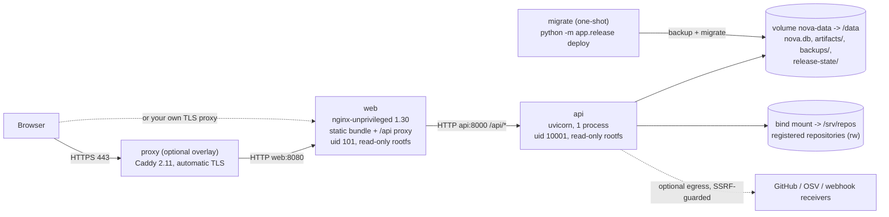

# Architecture and networking (production deployment)

NOVA is a **modular monolith**: one API process (FastAPI on uvicorn), one SQLite database file, one artifact directory, one static web bundle served by
nginx. Background work (indexing, analysis, reviews, test runs, optional integration worker) runs inside the API process with bounded concurrency.
No message broker, Kubernetes or managed cloud service is required.

## Service topology

Start order is enforced by compose: `migrate` must exit 0 (`service_completed_successfully`) before `api` starts; `web` waits for `api` to be healthy;
the TLS proxy waits for `web` to be healthy.

## Services, ports and storage

| Service | Image | Listens | Published on the host | Writes to | Limits |
|---|---|---|---|---|---|
| `migrate` | `nova-api` (`backend/Dockerfile`) | - | - | `/data` (database, `backups/`, `release-state/`) | read-only rootfs, `/tmp` 64 MB tmpfs, no capabilities |
| `api` | `nova-api` | `8000` (compose network only, `expose`) | **never** | `/data`, `/srv/repos` (approved repairs/refactorings) | 2 CPU, 2 GiB RAM, 512 pids, `/tmp` 256 MB tmpfs, no capabilities |
| `web` | `nova-web` (`frontend/Dockerfile`) | `8080` | `${NOVA_WEB_BIND:-127.0.0.1}:${NOVA_WEB_PORT:-8080}` | tmpfs only | 128 MiB RAM, no capabilities |
| `proxy` (optional, `docker-compose.tls.yml`) | `caddy:2.11.7-alpine` (digest-pinned) | `80`, `443` (+UDP 443) | `0.0.0.0:80/443` | `caddy-data`, `caddy-config` volumes | 256 MiB RAM, only `NET_BIND_SERVICE` |

The database port does not exist (SQLite is a file) and no administration service is exposed. The API is reachable only through `web`.

### Persistent data

| Path in container | Backed by | Contents | Backed up by `app.release backup` |
|---|---|---|---|
| `/data/nova.db` | volume `nova-data` | all application state, audit history, hashed tokens, encrypted credentials | yes (online snapshot) |
| `/data/artifacts/` | volume `nova-data` | generated tests, run outputs, staged candidates, validation scratch | yes (files + empty run directories) |
| `/data/backups/` | volume `nova-data` | verified backups (`NOVA_BACKUP_DIR`) | **copy off-host**: same volume as the data |
| `/data/release-state/deployments.jsonl` | volume `nova-data` | deployment history (`NOVA_RELEASE_STATE_DIR`) | no (informational) |
| `/srv/repos/` | host bind mount `NOVA_REPOS_HOST_DIR` | the repositories NOVA analyses | no - back them up with your SCM |
| `/tmp` | tmpfs | transient only | no |

Container root filesystems are read-only, so nothing outside these mounts survives a restart, and nothing writable is mistaken for permanent storage.

## Request path and limits

| Hop | Body limit | Timeouts | Headers |
|---|---|---|---|
| Caddy (optional) | 10 MB | Caddy defaults | adds HSTS, removes `Server` |
| nginx `web` | `client_max_body_size 10m` | connect 5 s, read/send 120 s | SPA: CSP, `X-Frame-Options DENY`, `nosniff`, `no-referrer`; `/assets/` cached 1 year; `index.html` revalidated |
| uvicorn `api` | `NOVA_MAX_REQUEST_BODY_BYTES` (8 MiB, 413 on declared or streamed size) | keep-alive 5 s, graceful shutdown 20 s | every `/api` response: `nosniff`, `X-Frame-Options DENY`, `Referrer-Policy no-referrer`, `CSP default-src 'none'`, `Cache-Control no-store`, `X-Request-ID` |

nginx resolves `api` through Docker's DNS on every request (`resolver 127.0.0.11`), so an API restart with a new container address does not leave a stale upstream.

## Client addresses (auth throttling and logs)

Invalid bearer tokens are throttled per client address (`NOVA_AUTH_FAILURE_LIMIT` per `NOVA_AUTH_FAILURE_WINDOW_SECONDS`, then HTTP 429 with `Retry-After`).
For that to key on the browser and not on a proxy:

1. Caddy sets `X-Forwarded-For` to the browser address.
2. nginx trusts `X-Forwarded-For` **only from private peers** (`10/8`, `172.16/12`, `192.168/16`, `127.0.0.1`) via `real_ip_*`, then overwrites the header with
   the resolved client address before proxying - clients cannot inject extra addresses through nginx.
3. uvicorn trusts forwarding headers from any peer (`FORWARDED_ALLOW_IPS=*` in compose) because the API port is not published; only `web` can reach it.

If you publish port 8000 or put a proxy on a public address in front of nginx, change these trust settings accordingly. Verified in the rehearsal:
20 invalid tokens from `203.0.113.50` (via nginx) -> 429 for that address, other addresses unaffected (`FINAL_DEPLOYMENT_REPORT.md`).

## Egress

The API makes outbound calls only for features an administrator enables: AI-assisted repair proposals (`NOVA_AI_PROVIDER=anthropic`: HTTPS to the Anthropic API, only when a user requests a proposal, with the investigation's relevant files after secret scrubbing - `docs/architecture/AI_ASSISTED_REPAIR.md`), GitHub / tracker integrations and webhook deliveries (SSRF-guarded: private,
loopback, link-local and metadata addresses are refused unless `NOVA_INTEGRATION_ALLOW_PRIVATE_DESTINATIONS=true`, which production refuses), live OSV
lookups (`NOVA_SECURITY_OSV_ENABLED`, default off), and operations notifications (`NOVA_OPS_WEBHOOK_URL`). With none configured the API needs no egress.
Repository test code executed by approved test runs inherits the container's network access (the runner is not a sandbox).

## Security boundaries

* **Authentication:** a global bearer token (`NOVA_API_TOKEN`, required in production) and per-user tokens (`nova_u_...`, hashed at rest). Liveness
  and readiness are the only unauthenticated API routes; interactive API docs are off in production.
* **Authorization:** deny-by-default roles, organization/workspace scoping, 404 for out-of-scope objects (route-wide sweeps in the test suite).
* **Repository code execution:** approved test runs execute repository code as uid 10001 in a restricted subprocess (stripped environment, resource
  limits, process group kill). It is **not** a sandbox: it can read and write `/data` and reach the network. Mitigations shipped in 0.19.0: the API process
  is non-dumpable, so a test cannot read the API's environment (`/proc/<pid>/environ`) - verified with a hostile test; and `NOVA_TEST_EXECUTION_ENABLED=false`
  disables all execution. Register only trusted repositories when execution is enabled.
* **Git:** argument arrays only, hardened config, `GIT_CEILING_DIRECTORIES` so git never discovers a repository above the registered root.

## Why one API process

SQLite allows one writer at a time; background jobs, the auth throttle, telemetry rings and job admission limits are per process. Running more than one
API process (or replica) against the same volume is unsupported. Scale up the single container (CPU/RAM) instead. Moving to PostgreSQL and multiple
processes would be a separate project: the migrations use SQLite batch operations, append-only audit tables rely on SQLite triggers, and the backup tooling
is SQLite-specific (`PRODUCTION_CONFIGURATION.md`, "Database").
