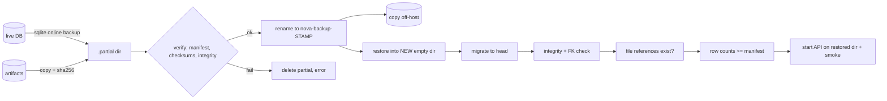

# Backup, restore and data integrity

## Data classes

| Data | Where | Class | Handling |
|---|---|---|---|
| Users, orgs, teams, roles, policies, workflows, reviews, tasks, **audit events**, integration events, webhook deliveries/outbox, hashed tokens | SQLite DB | **Backed up** | online-backup snapshot |
| Encrypted integration credentials / webhook secrets | DB (AES-GCM ciphertext) | **Backed up** (ciphertext) | the **key is not in the backup** - store it separately |
| Generated tests, run output, staged candidates | `NOVA_ARTIFACT_DIR` | **Backed up** | copied with SHA-256 per file; empty run directories recorded in `artifact_dirs` and recreated (0.19.0); `*-tmp` scratch dirs skipped |
| Code index, symbols, graph, embeddings-style derived rows | DB | Derived / rebuildable | included because they are in the DB; re-index is the fallback |
| Registered repositories' source code | user's disk | **Not NOVA's data** | back up with your SCM |
| Logs, metrics rings, traces | process memory / stdout | Not backed up | operational, ephemeral |

## Backup

`python -m app.release backup [--backup-dir <dir>] [--label x]` (mutating, safe to run while the API is up). Default directory: `NOVA_BACKUP_DIR` (image: `/data/backups`).

* Uses SQLite's online-backup API, so the snapshot is consistent under concurrent writes.
* Built in `.partial-<name>/`, **self-verified**, then atomically renamed to `nova-backup-<UTCstamp>[-label]/`. A crash leaves only a `.partial-*` directory, which is listed as invalid and never mistaken for a backup.
* `manifest.json`: format, timestamp, app version, source revision, schema revision, code head, DB size + SHA-256, row counts per table, every artifact path + SHA-256 + size, and what is *not* included.
* Directory/file modes are set to owner-only where the filesystem supports it.
* A snapshot with structural corruption is refused; foreign-key orphans are reported at restore time rather than hidden.

`verify <dir>` (read-only) checks manifest, checksums, every artifact and `PRAGMA integrity_check`. `list-backups` flags invalid/partial entries.

`prune --keep N` removes the oldest **valid** backups beyond N, never an invalid/partial directory (those need a human) and never the last valid backup.



## Restore (never in place)

`python -m app.release restore <backup-dir> --target <NEW empty dir>`

1. Verifies the backup first; refuses a target that already holds files. **There is no overwrite option.**
2. Copies DB + artifacts, migrates to the current head if the backup is older, runs integrity + foreign-key checks, confirms every DB-referenced artifact path exists (`test_generation_runs.artifact_dir`, `test_execution_runs.artifact_dir`, `test_candidates.staged_path`) and that no table lost rows.
3. Exit 0 only when all pass. The report lists what failed.
4. To use the restored copy: stop the API, point `NOVA_DATABASE_URL` / `NOVA_ARTIFACT_DIR` at the restored directory (or move the old directories aside - do not delete them until validated), start, run `smoke`. Procedure and warnings: RB-08.

## Targets and measurements

* **RPO / RTO are targets you set, not properties of this software.** With a nightly `backup` job the RPO is up to 24 h; with hourly, 1 h. RTO = time to run steps in RB-08 plus validation.
* **Measured, synthetic, this sandbox only (not representative of production):** a 53 MB database (50,000 rows in a scratch table) + 2,000 four-KB artifact files: backup 0.64 s, verify 0.08 s, restore + migrate-check + integrity + reference check 0.72 s. Fresh migration of an empty database: 4.8 s. Real data volumes, disks and network copies will differ; measure with your own data during a DR drill.
* **Rehearsal on 2026-10-22 (WSL2 Ubuntu, Python 3.12, small real data set: 1 indexed repository, analysis, review, test runs, tasks):** online backup while the API served requests 0.98-4.12 s, verify ok, tampered copy rejected (`checksum does not match`), isolated restore 1.17 s with `ok: true` (integrity, FK, 0 missing file references, no row loss), a second API started on the restored data passed 18/18 smoke checks and reported identical counts.
* A DR drill on separate hardware has **not** been performed, and the container form of these commands has not been executed (no Docker; the CI `containers` job runs it).

## Integrity tests that exist

Round trip, empty artifact directories preserved (a refused test run used to break every later restore - fixed in 0.19.0), `integrity` on an unmigrated database reports instead of crashing, tamper detection (artifact and database), interrupted backup, partial/invalid listing, prune safety, refusal to restore over existing data, missing-referenced-file detection on restore, upgrade from the previous revision preserving row counts, and failed migration leaving the database and a usable pre-migration backup.

## Container commands (compose deployment)

`COMPOSE` as defined in `DEPLOYMENT_GUIDE.md`. Backups land on the same volume as the data, so **copy them off the host** every time.

```bash
$COMPOSE exec api python -m app.release backup --label nightly               # -> /data/backups/nova-backup-<UTC>-nightly
$COMPOSE exec api python -m app.release list-backups
$COMPOSE exec api python -m app.release verify /data/backups/<name>
$COMPOSE cp api:/data/backups/<name> /mnt/offhost/nova/                      # then sync to object storage / another host
$COMPOSE exec api python -m app.release prune --keep 14                       # never removes the last valid backup
```

Schedule the backup with the host's scheduler (example crontab, 02:15 daily):
`15 2 * * * cd /opt/nova && docker compose -f deployment/docker-compose.yml --env-file deployment/production.env exec -T api python -m app.release backup --label nightly`

The integration encryption key (`NOVA_INTEGRATION_SECRET_KEY`) and `deployment/production.env` are **not** in the backup; keep them in your secret store.

### Restore and switch (isolated, never in place)

```bash
$COMPOSE exec api python -m app.release restore /data/backups/<name> --target /data/restore-<date>   # must print "ok": true
# test it with a second API on the restored copy before switching (inside the running container, port 8001, 20 s):
$COMPOSE exec api sh -c 'NOVA_DATABASE_URL=sqlite:////data/restore-<date>/db.sqlite3 NOVA_ARTIFACT_DIR=/data/restore-<date>/artifacts   timeout 20 uvicorn app.main:create_app --factory --host 127.0.0.1 --port 8001 & sleep 8; python -m app.release smoke --url http://127.0.0.1:8001'
# switch: add to deployment/production.env, then recreate the containers
#   NOVA_DATABASE_URL=sqlite:////data/restore-<date>/db.sqlite3
#   NOVA_ARTIFACT_DIR=/data/restore-<date>/artifacts
$COMPOSE up -d && python3 scripts/deployment_smoke.py --url http://127.0.0.1:8080
```

Keep the previous `/data/nova.db` and `/data/artifacts` until the restored deployment is validated - they are the only copy of anything written after
the backup. A restore onto a new host is the same procedure after copying the backup directory into the new `nova-data` volume
(`$COMPOSE cp <local backup dir> api:/data/backups/`).
