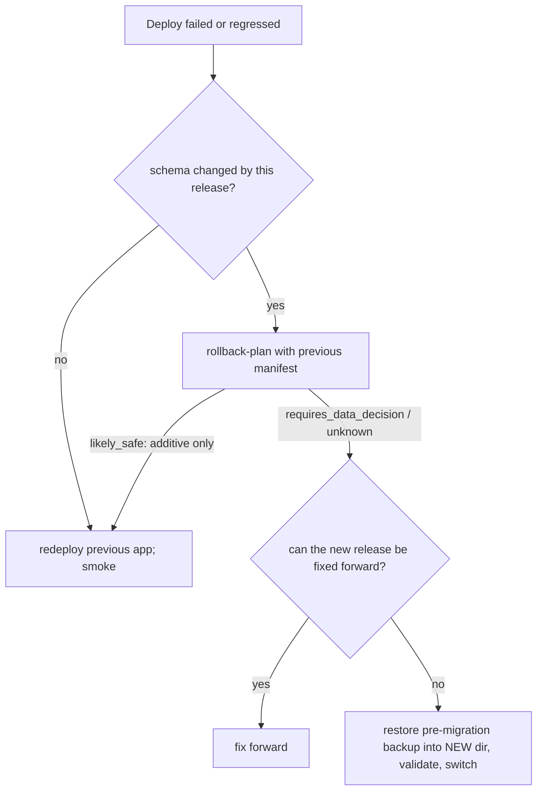

# Rollback

Rollback is five different operations. NOVA **never runs a schema downgrade automatically** and rollback never deletes uploads or resets the database.

| Kind | What it means | How |
|---|---|---|
| Application | run the previous release's code | redeploy the previous image/checkout; `python -m app.release rollback-plan <previous release-manifest.json>` says whether it is compatible with the current schema |
| Schema | revert migrations | **manual only**. Prefer expand-and-contract (additive migrations) so the previous code keeps working on the new schema; `classify` marks each revision additive or "needs review" |
| Data | return to an earlier state | restore a backup into a **new** directory (RB-08), validate, then switch the service to it. Data written after that backup is lost - decide explicitly |
| Config | undo a setting change | restore the previous env file; `check-config` before restart |
| Credential | undo a rotation | previous tokens/keys are not recoverable by design; issue new ones. Keep the previous encryption key in `..._KEYS_PREVIOUS` until re-encryption is verified |

## Decision procedure



Validation after any rollback: `status` (schema as expected), `integrity`, `smoke` (health, readiness, authenticated critical endpoints), and spot-check audit history is intact. A failed rollback: RB-06.

`rollback-plan` outputs `safe` (database already at the previous head), `likely_safe` (only additive revisions after it - a heuristic, review the listed revisions), `requires_data_decision`, or `unknown`; `downgrade_executed` is always `false`.

## Container rollback procedure

Rollback needs the previous images, so **tag every release** instead of reusing `local`: set `NOVA_IMAGE_TAG=<version>` (e.g. `0.19.0`) in
`deployment/production.env` before `$COMPOSE build`, and keep the previous release's tag and its `release-manifest.json`.

```bash
$COMPOSE exec api python -m app.release history                           # what was deployed, which pre-migration backup was taken
$COMPOSE exec api python -m app.release rollback-plan /data/previous-release-manifest.json   # copy the previous manifest in first ($COMPOSE cp)
```

| `rollback-plan` says | Do |
|---|---|
| `safe` / `likely_safe` | set `NOVA_IMAGE_TAG` back to the previous tag, `$COMPOSE up -d`, run `scripts/deployment_smoke.py`. The previous code ignores additive schema changes. |
| `requires_data_decision` / `unknown` | prefer **fix forward**. Otherwise restore the `pre-migration` backup into a new directory, switch to it with the previous tag (`BACKUP_AND_RESTORE.md`, "Restore and switch"), smoke test. Writes made after the migration are lost - decide explicitly. |

Never edit `alembic_version` by hand and never run `alembic downgrade` against production data: migration `0002` is classified non-additive, and a
downgrade can drop columns that hold data. Restoring the verified pre-migration backup is the supported way back.

### Recovery scenarios

| Scenario | Procedure |
|---|---|
| Bad configuration | restore the previous `production.env` (keep a dated copy), `check-config`, `$COMPOSE up -d` |
| API will not start (config or schema) | `RUNBOOK.md` RB-05 |
| Migration failed | `RUNBOOK.md` RB-04 - the database was not recreated; the pre-migration backup is named in the error |
| Host or volume lost | `RUNBOOK.md` RB-16 (needs an off-host backup, the encryption key and `production.env`) |
| Compromised credential | `INCIDENT_RESPONSE.md` |
